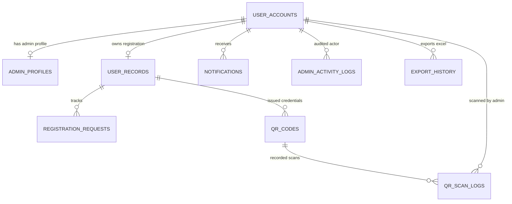

# Secure QR Verification System — Entity-Relationship Diagram

## Key Security Invariants
- `otp_verifications.otp_hash` stores HMAC-SHA256 digests only; plaintext OTPs are never persisted.
- `qr_codes.token_hash` stores SHA-256 digests of 256-bit `secrets.token_urlsafe(32)` tokens; plaintext tokens are never stored in database tables.
- Only `APPROVED` `user_records` with `user_accounts.is_active = 1` can hold an `ACTIVE` QR credential.
